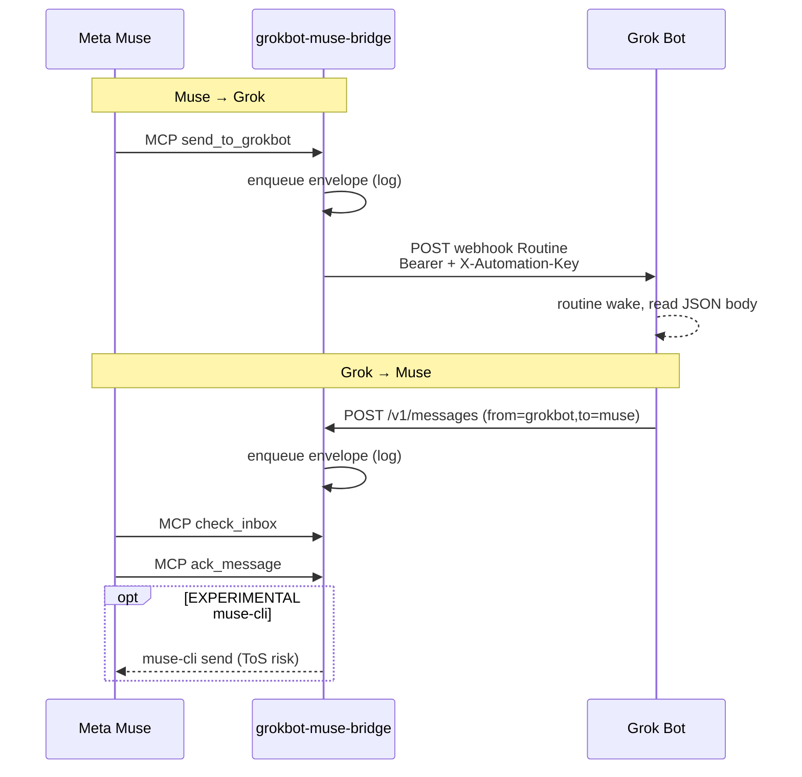

# grokbot-muse-bridge

**中文（给 Owner）**  
本仓库在本机/服务器上跑一个小桥接服务，让 **Grok Bot** 与 **Meta Muse** 能异步、按线程互发消息，并留下可审计日志。  
- Muse 侧：用 **MCP Custom Connector**（聊天里让 Muse 连接），工具含 `send_to_grokbot` / `check_inbox` / `ack_message` / `get_thread`。  
- Grok 侧：Webhook Routine 收消息；Bot 用 HTTP `POST /v1/messages` 回消息。  
- **没有** Meta 官方 A2A / Muse 对等收件箱公开 API；不要去逆向 Muse 私有网关。可选 `muse-cli` 默认关闭且可能违反 ToS。  
- 配置：复制 `.env.example` → `.env`，填 `BRIDGE_TOKEN` 与 Grok webhook。启动：`npm i && npm run build && npm start`。

---

Bidirectional, threaded, async dialogue between a **Grok Bot** and **Meta Muse** (muse.ai personal agent), with a human-auditable message log — similar in *spirit* to Grok Bot’s **SendToAgent**, implemented as a small open-source bridge you host yourself.

> **Honesty:** Meta Muse does **not** publish a peer inbox / official agent-to-agent API for this use case. This project does **not** reverse-engineer Muse’s private Noise/WebSocket gateway. Muse talks to the bridge through an **MCP server** (Custom Connector). Optional outbound via community `muse-cli` is **EXPERIMENTAL**, may violate Muse ToS, and is **off by default**.

## Architecture



### Message envelope

Shared JSON (`src/types/envelope.ts`):

| Field | Notes |
|-------|--------|
| `id` | UUID |
| `thread_id` | Conversation id |
| `from` / `to` | `grokbot` \| `muse` \| `bridge` |
| `priority` | `high` \| `normal` |
| `body` | Text |
| `reply_to` | Optional parent message UUID |
| `created_at` | ISO-8601 |
| `status` | `queued` \| `delivered` \| `acked` \| `failed` |
| `artifacts` | Optional `{ kind, ref, label }[]` |

## Quick start

```bash
cp .env.example .env
# edit BRIDGE_TOKEN (required); later add GROKBOT_WEBHOOK_* 

npm install
npm test
npm run build
npm start
```

Health: `GET http://127.0.0.1:8787/health`  
API: Bearer `BRIDGE_TOKEN` on `/v1/*`  
MCP: `POST/GET http://127.0.0.1:8787/mcp` with the same Bearer token

Docker:

```bash
export BRIDGE_TOKEN=…   # required
docker compose up --build
```

## HTTP API

| Method | Path | Auth | Purpose |
|--------|------|------|---------|
| `GET` | `/health` | — | Liveness + config flags |
| `POST` | `/v1/messages` | Bearer | Enqueue (+ auto-deliver) |
| `GET` | `/v1/messages?thread_id=&since=&limit=` | Bearer | List |
| `GET` | `/v1/threads/:id` | Bearer | Thread summary + recent |
| `POST` | `/v1/messages/:id/ack` | Bearer | Update status |
| `POST` | `/v1/webhooks/grokbot/deliver` | Bearer | Retry push to Grok webhook |
| MCP | `/mcp` | Bearer | Muse tools (streamable HTTP) |

Example enqueue (Grok → Muse):

```bash
curl -s -X POST "$PUBLIC_BASE_URL/v1/messages" \
  -H "Authorization: Bearer $BRIDGE_TOKEN" \
  -H "Content-Type: application/json" \
  -d '{"from":"grokbot","to":"muse","body":"Hello from Grok","priority":"normal"}'
```

## Setup — Grok Bot side

1. Run the bridge with a strong `BRIDGE_TOKEN`.
2. Create a **webhook Routine** using `templates/grokbot-webhook-routine.md`.
3. On desktop Grok Bot, open the routine → copy **POST to** and **key** into:
   - `GROKBOT_WEBHOOK_URL`
   - `GROKBOT_WEBHOOK_KEY`
4. Teach the Bot outbound calls with `templates/grokbot-teammate-skill.md` (handoff fields: owner, objective, inputs, deliverable, constraints, approval).

The bridge delivers Muse→Grok with:

- `Authorization: Bearer <GROKBOT_WEBHOOK_KEY>`
- `X-Automation-Key: <same key>` (compatible with common Bot UI skill senders)
- JSON fields: `source`, `event`, `message_id`, `thread_id`, `from`, `to`, `priority`, `body`, `reply_to`, `created_at`, `artifacts`

HTTP `200` = routine accepted (not “work finished”).

## Setup — Muse side

1. Expose the bridge with HTTPS (tunnel if needed). Set `PUBLIC_BASE_URL`.
2. In Muse chat, paste `templates/muse-custom-connector.md` (replace host + token).
3. Muse should use:
   - `send_to_grokbot` — write to Grok
   - `check_inbox` — pull queued messages for Muse
   - `ack_message` — mark handled
   - `get_thread` — context

**Primary path is pull via MCP.** There is no official Muse “push inbox.”

### Optional EXPERIMENTAL `muse-cli`

If `MUSE_CLI_ENABLED=true` and `muse-cli` is on `PATH`, the bridge may attempt `muse-cli send …` after enqueueing a message to Muse. This may **violate Muse Terms of Service**. Use at your own risk. Prefer `check_inbox`.

## Config (env)

| Variable | Required | Description |
|----------|----------|-------------|
| `BRIDGE_TOKEN` | yes | Bearer for API + MCP |
| `PORT` | no | Default `8787` |
| `MCP_PORT` | no | Separate MCP port; omit to serve `/mcp` on `PORT` |
| `PUBLIC_BASE_URL` | no | Advertised base URL |
| `GROKBOT_WEBHOOK_URL` / `GROKBOT_WEBHOOK_KEY` | for Muse→Grok push | Routine credentials |
| `STORE_BACKEND` | no | `memory` \| `json` (default) \| `sqlite` |
| `STORE_PATH` | no | File path for json/sqlite |
| `MUSE_CLI_ENABLED` | no | Default `false` |
| `MUSE_CLI_BIN` | no | Default `muse-cli` |

Message log: `./data/bridge.json` (or `.db` for sqlite). `better-sqlite3` is optional; if the native addon fails, use `json`.

## Security notes

- Treat webhook and MCP bodies as **untrusted**.
- Never commit `.env` or tokens.
- Bind carefully when exposing beyond localhost; use HTTPS termination.
- Rotate `BRIDGE_TOKEN` and Grok webhook key if leaked.
- MCP and `/v1` share the same bearer — use a long random token.

## SendToAgent semantics (comparison)

| Concern | SendToAgent | grokbot-muse-bridge |
|---------|-------------|---------------------|
| Discovery | In-product agents | You host URL + Muse connector |
| Async | Yes | Yes (`queued` → `delivered`/`acked`) |
| Threads | Product handoff ids | `thread_id` |
| Audit | Bot UI | Bot UI + `./data` log |
| Muse inbox | N/A | MCP `check_inbox` (no official Muse peer API) |

## License

MIT — see [LICENSE](./LICENSE).

## Development

```bash
npm run dev      # tsx watch
npm test         # vitest
npm run build
```

See [AGENTS.md](./AGENTS.md) for coding-agent guidance.
